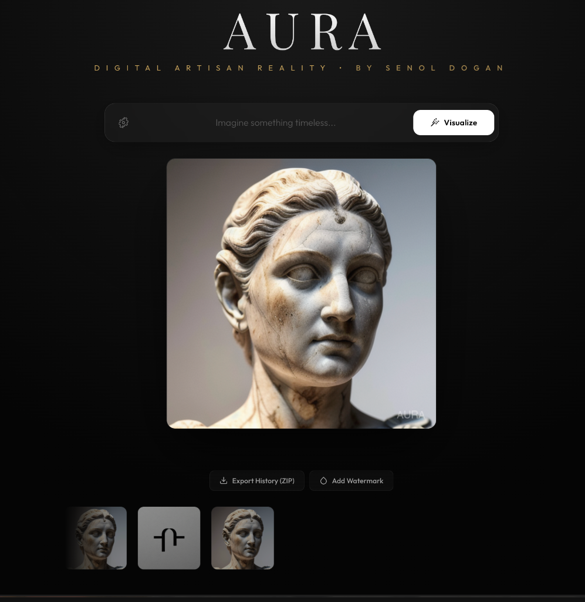
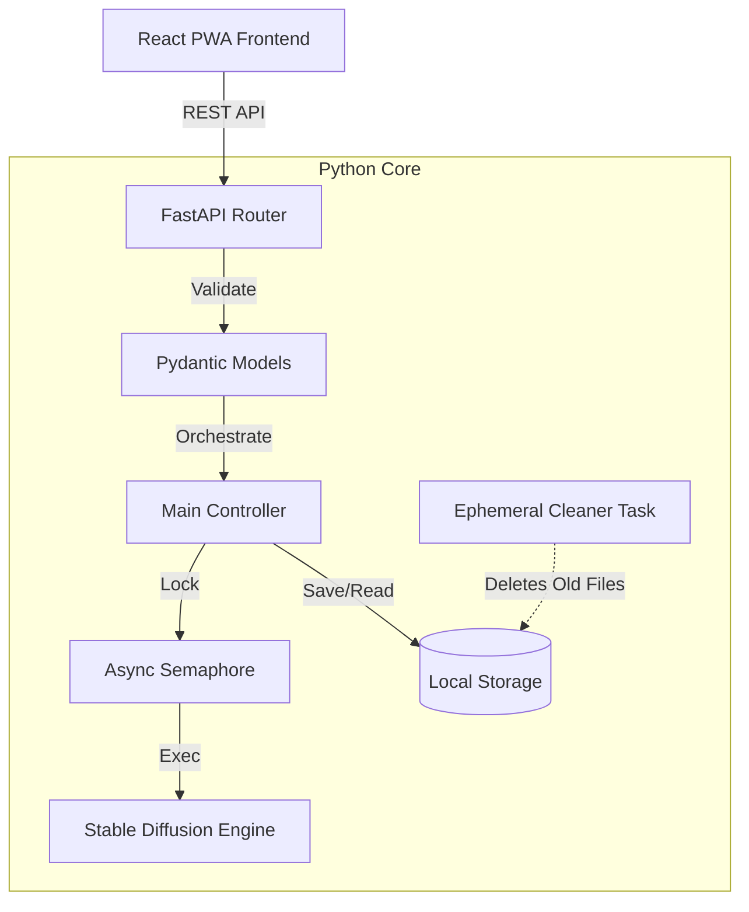

# <div align="center">A U R A — Digital Artisan Reality 🎨</div>

<div align="center">




**A privacy-first, portfolio-grade AI Image Generation Studio.**  
*Ephemeral Storage • Hardware Semaphore Queue • Headless UI Architecture • PWA Support*

[Features](#-key-features) • [Architecture](#-architecture) • [Getting Started](#-getting-started) • [Tech Stack](#-tech-stack)

</div>

---

## 💎 Project Overview

**AURA** is an engineering showcase that demonstrates how to build a **Full-Stack AI Application** with production-level standards. Unlike simple wrappers, AURA implements a robust **Job Queue System** (using `asyncio.Semaphore`) and **Ephemeral Storage** logic to manage hardware resources and user privacy effectively.

It is designed as a **Progressive Web App (PWA)** with a "Luxury" design language, featuring glassmorphism, micro-interactions, and a native mobile feel.

## ✨ Key Features

### 🛡️ Privacy & Security
- **Ephemeral Storage**: No localized database. Generated images are auto-deleted after 1 hour (Configurable TTL).
- **No Cookies/Auth needed**: Zero-friction anonymous usage.

### ⚡ Performance & Engineering
- **Concurrency Control**: Strict Semaphore locking ensures your GPU is never overloaded by parallel requests.
- **Background Tasks**: Automated cleanup jobs run asynchronously to maintain server health.
- **Headless UI Hook**: Frontend logic is fully decoupled into `useAuraEngine`, separating Business Logic from Presentation.

### 🎨 User Experience
- **Smart Prompt Engineering**: Automatically enhances simple prompts (e.g., "cat" -> "cinematic shot of a cat, 8k, highly detailed").
- **Auto Aspect Ratio**: Detects intent (e.g., "tall building" -> Portrait Mode) automatically.
- **PWA Ready**: Installable on iOS and Android.

---

## 🏗️ Architecture

The project follows a **Level 2 Modular Monolith** architecture:



### Directory Structure

```bash
├── backend/
│   ├── config.py       # Central Configuration (Env)
│   ├── main.py         # API Routes & LifeCycle
│   ├── schemas.py      # Data Contracts (DTOs)
│   ├── utils.py        # Business Logic (Prompt Magic)
│   └── sd_engine.py    # AI Model Wrapper
└── frontend/
    ├── src/hooks/      # Logic Layer (useAuraEngine)
    ├── src/components/ # Presentational Components
    └── src/App.tsx     # Composition Layer
```

---

## 🚀 Getting Started

### Prerequisites
- **Python 3.10+**
- **Node.js 18+**
- **GPU Recommended**: NVIDIA (CUDA) or Mac (M1/M2/M3). *Runs on CPU but slower.*

### 1. Backend Setup

```bash
cd backend
python -m venv .venv
source .venv/bin/activate  # Windows: .venv\Scripts\activate

pip install -r requirements.txt

# Run the API server
python main.py
```
*Port: `8000`. On first run, models (~4GB) will be downloaded automatically.*

### 2. Frontend Setup

```bash
cd frontend
npm install

# Run the Development Server
npm run dev
```
*Port: `5173`. Open `http://localhost:5173` to view the app.*

---

## 🛠️ Configuration

Rename `backend/.env.example` to `.env` to customize:

```env
HOST=127.0.0.1
PORT=8000
EPHEMERAL_TTL=3600  # Seconds before file deletion
```

---

## 📦 Tech Stack

- **Core**: Python, TypeScript
- **Backend Framework**: FastAPI, Uvicorn
- **AI/ML**: PyTorch, Diffusers, Huggingface
- **Frontend**: React, Vite, Framer Motion
- **Tooling**: Pydantic, ESLint, PostCSS

## 👨‍💻 Author

**Senol Dogan**  
*Senior Software Architect*

- 🌐 **Website**: [www.senoldogan.dev](https://www.senoldogan.dev)
- 📧 **Email**: [contact@senoldogan.dev](mailto:contact@senoldogan.dev)
- 🐙 **GitHub**: [@senoldogan](https://github.com/senoldogan)

---

<div align="center">

*Crafted by [Senol Dogan](https://www.senoldogan.dev) for the Open Source Community.*

</div>
